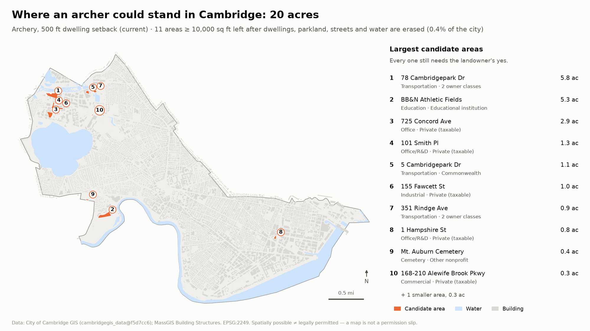
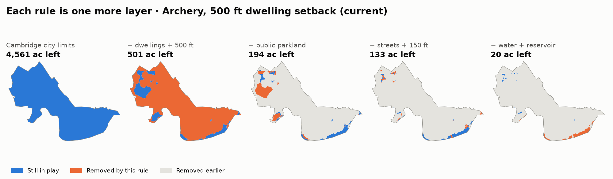
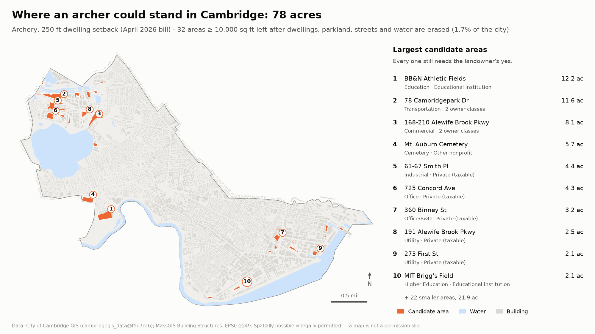
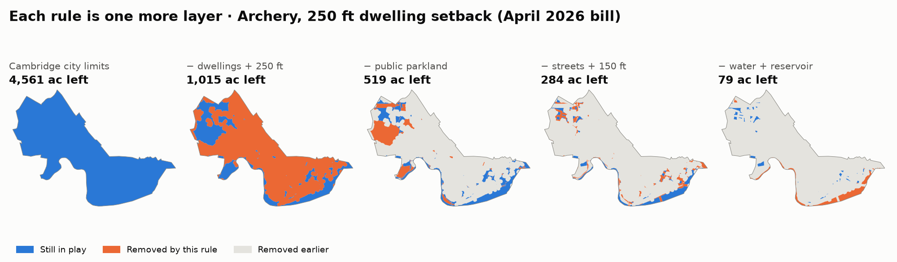

# Can I hunt my Thanksgiving turkey in Cambridge? Methodology

This companion to the Fall NEARC 2026 lightning talk explains how the candidate map was made, what each number means, and what the analysis does not answer. Code and data provenance are in the [README](../README.md).

## Summary

| Scenario | Candidate acres | Areas | Share of city |
|---|---:|---:|---:|
| Firearm | 0 | 0 | 0% |
| Archery, 500 ft dwelling setback (current) | 20.0 | 11 | 0.4% |
| Archery, 250 ft dwelling setback (April 2026 bill) | 78.1 | 32 | 1.7% |

- **Firearms: no.** Cambridge bans firearm discharge citywide, so no other layer matters.
- **Archery: almost no.** The city bans bows only in streets and on bridges (§9.16.060), so state setbacks and the other layers decide the answer. At the current 500 ft setback, 20 acres survive in 11 pieces.
- **Every candidate acre is someone's land.** None of it can be used without the landowner's permission.
- **The largest 500 ft candidate is crossed by active rail track** (see [Known gaps](#known-gaps-and-limitations)).

A candidate is land where the rules as mapped here don't rule hunting out. It is not a place where hunting is permitted. The map shows what is spatially possible, not what is legally allowed.

## Question and scope

**Question.** Where inside Cambridge city limits could an archer stand without breaking any of the spatial rules in the talk?

**Answer unit.** Polygons of land (candidates) of at least 10,000 sq ft, each split by parcel and tagged with the class of owner who would have to say yes.

**Out of scope.** Rules that are not about location: hunting license and turkey permit, season dates and zone, legal days and hours, and whether a landowner actually agrees. Also out of scope: the direction of the shot and what is behind the target.

## Rules as geometry

Each written rule becomes one geometry and one GIS operation (slides 2–3 of the talk). Rules are paraphrased; check the current text before relying on any of them.

| # | Rule (paraphrased) | Source | Data | Operation | Parameter |
|---|---|---|---|---|---|
| 1 | No firearm discharge in city limits | Cambridge ordinances [5] | City boundary | Select: zeroes the city | Firearm scenario only |
| 2 | No hunting within the setback of a dwelling in use, unless its owner or occupant allows it | MGL c.131 §58 [6]; 321 CMR 3.00 [1]; setback bill [2] | Building footprints, land use, MassGIS structures | Buffer + erase | 500 ft (current), 250 ft (bill) |
| 3 | No hunting on public parkland | Talk, slide 2 | Open space | Erase | Owner is City, State, Federal, School Dept., Belmont, POPS, easement or blank |
| 4 | No bows in streets or on bridges; no arrow released within 150 ft of a hard-surfaced highway | Cambridge §9.16.060 [5]; MGL c.131 §58 [6] | Road surface polygons, bridges | Erase streets and bridges; buffer hard surfaces + erase | 150 ft |
| 5 | Stay off the water and back from the water supply | Talk, slide 2; buffer width from 310 CMR 22.02 Zone A [7] | Water bodies | Erase all water; buffer Fresh Pond + erase | 400 ft |
| 6 | Only with landowner permission | Talk, slide 2 | Land-use parcels | Overlay + tag owner class (not an erase) | — |

All parameters live in [`config.toml`](../config.toml), so a changed rule means editing one number and rerunning.

## Data

| Layer | Source | Version | Used for |
|---|---|---|---|
| City boundary | City of Cambridge GIS [3] | `cambridgegis_data` at commit `f5d7cc6` (2026-11-03) | Study area |
| Buildings | City of Cambridge GIS | same | Dwellings |
| Land use FY2027 | City of Cambridge GIS | same | Deciding which buildings are dwellings; owner class |
| Open space | City of Cambridge GIS | same | Parkland |
| Roads (surface polygons) | City of Cambridge GIS | same | Streets, hard-surfaced roads |
| Bridges | City of Cambridge GIS | same | Bridges |
| Water bodies | City of Cambridge GIS | same | Water, Fresh Pond |
| Building Structures (2-D) | MassGIS [8] | Queried 2026-11-17 | Structures in neighboring towns within 600 ft of the city line |

The talk cites MassGIS parcels [4] for ownership. This analysis uses the City's parcel-based land-use layer instead, because it also carries use category, residential units and tax status.

Every layer is reprojected to EPSG:2249 (NAD83 / Massachusetts Mainland, US survey feet), so each buffer distance is in the same feet the rules use. File hashes and source URLs are in `data/raw/manifest.json`.

## Method

1. **Study area.** The Cambridge city boundary covers 4,561 acres. That includes the Charles River and Fresh Pond surface inside city limits.
2. **Dwellings.** A Cambridge building (type `BLDG` or `MOBILE`) is a dwelling if a point inside its footprint falls on a land-use parcel that:
   - has residential units, or
   - is flagged as group quarters, or
   - has a use where people sleep but the assessor may record no units: higher education, education residential, education with commercial, health, hotel, charitable/religious.

   The last group matters because campus parcels lump dorms in with labs and record no residential units. Without it, about 41 acres of university parcels along Massachusetts Avenue come out as 500 ft candidates. Under this definition, 12,330 of 14,278 Cambridge buildings are dwellings.

   The state structures layer has no use code, so every MassGIS structure of at least 200 sq ft that sits outside Cambridge and within 600 ft of the line also counts as a dwelling (2,916 of them). Without these, land along the border would pass the setback test only because the neighboring houses are missing from the city's data.
3. **Exclusion layers.** Each rule becomes one polygon clipped to city limits:
   - **Dwellings:** footprints buffered by the scenario's setback, measured from the footprint edge.
   - **Parkland:** open-space polygons with a public owner, or POPS (privately owned public space, which is publicly accessible).
   - **Roads:** all road-surface polygons (paved, alley, bridge deck, traffic island, unpaved), plus 150 ft around hard-surfaced ones, plus the bridges layer.
   - **Water:** all water bodies, plus 400 ft around Fresh Pond, the city's reservoir.
4. **Waterfall.** The layers are erased from the city in order: dwellings, parks, roads, water. The order changes how much each step appears to remove, but not what remains.
5. **Slivers.** Pieces smaller than 10,000 sq ft (about 0.23 acre) are dropped.
6. **Permission.** Candidates are intersected with land-use parcels. Each piece gets an owner class from the assessor's tax status: City NonTax becomes "City of Cambridge", Educ NonTax becomes "Educational institution", and so on. A blank tax status becomes "Private (taxable)".

## Results

### Archery, 500 ft setback (current)

| Step | Acres left | Removed by this step | Only this rule |
|---|---:|---:|---:|
| Cambridge city limits | 4,561 | — | — |
| − dwellings + 500 ft | 501 | 4,060 | 310 |
| − public parkland | 194 | 308 | 76 |
| − streets + 150 ft | 133 | 61 | 42 |
| − water + reservoir | 20 | 113 | 113 |
| − slivers under 10,000 sq ft | 20.0 | 0.2 | — |

**Only this rule** is the acreage that would come back if that one rule were dropped and all the others kept. It is a fairer measure of each rule's weight than "removed by this step", which depends on the erase order. The dwelling setback removes 89% of the city, yet dropping it alone would return only 310 acres, because parks, roads and water cover much of the same ground.

Of water's 113 acres, 112.5 are the Charles River surface. It is the one large stretch of Cambridge that is more than 500 ft from every house, not parkland and not road.

| # | Site | Use | Owner class | Acres |
|---:|---|---|---|---:|
| 1 | 78 Cambridgepark Dr | Transportation | 2 owner classes (mostly Commonwealth) | 5.84 |
| 2 | BB&N Athletic Fields | Education | Educational institution | 5.27 |
| 3 | 725 Concord Ave | Office | Private (taxable) | 2.93 |
| 4 | 101 Smith Pl | Office/R&D | Private (taxable) | 1.26 |
| 5 | 5 Cambridgepark Dr | Transportation | Commonwealth | 1.08 |
| 6 | 155 Fawcett St | Industrial | Private (taxable) | 0.96 |
| 7 | 351 Rindge Ave | Transportation | 2 owner classes | 0.89 |
| 8 | 1 Hampshire St | Office/R&D | Private (taxable) | 0.80 |
| 9 | Mt. Auburn Cemetery | Cemetery | Other nonprofit | 0.41 |
| 10 | 168-210 Alewife Brook Pkwy | Commercial | Private (taxable) | 0.29 |
| 11 | 273 First St | Utility | Private (taxable) | 0.25 |

By owner class: private (taxable) 9.7 ac, educational institution 5.3 ac, Commonwealth 4.3 ac, other nonprofit 0.4 ac. None of it is City of Cambridge land.

### Archery, 250 ft setback (April 2026 bill)

| Step | Acres left | Removed by this step | Only this rule |
|---|---:|---:|---:|
| Cambridge city limits | 4,561 | — | — |
| − dwellings + 250 ft | 1,015 | 3,547 | 251 |
| − public parkland | 519 | 496 | 150 |
| − streets + 150 ft | 284 | 235 | 180 |
| − water + reservoir | 79 | 205 | 205 |
| − slivers under 10,000 sq ft | 78.1 | 0.7 | — |

Halving the setback roughly quadruples the candidate land, from 20 to 78 acres in 32 pieces. Most of the added land is in the Alewife commercial and industrial area, with more in East Cambridge and Kendall; the BB&N fields and the Mt. Auburn Cemetery piece also grow. By owner class: private (taxable) 46.0 ac, educational institution 14.3 ac, Commonwealth 9.2 ac, other nonprofit 6.6 ac, Federal 0.5 ac, City of Cambridge 0.2 ac. The full list is in `outputs/candidates_archery_250ft.csv`.

## Sensitivity: what counts as a dwelling

"Dwelling in use" moves the answer more than the setback bill does.

| Dwelling definition | 500 ft | 250 ft |
|---|---:|---:|
| Buildings on parcels with residential units only | 72.6 ac | 169.7 ac |
| Plus dorm, hotel, hospital and similar parcels (**used**) | 20.0 ac | 78.1 ac |
| Every building in the city | 0.4 ac | 10.6 ac |

Counting units alone leaves 56 acres of educational-institution land in play at 500 ft, mostly university parcels on Massachusetts Avenue where students live in dorms the assessor doesn't count as units. Counting every building as a dwelling is too strict, since offices and labs are not dwellings, but it bounds the answer. Under that reading, the only 500 ft candidate in Cambridge is 0.4 acre inside Mt. Auburn Cemetery.

## Known gaps and limitations

- **Active rail is not a rule here.** Railroad property is not somewhere the public can be, but the talk's stack has no rail layer. The largest 500 ft candidate (archery_500ft-07, 5.8 ac, mostly a state-owned Transportation parcel by Cambridgepark Drive) is crossed by active track in the City's rail layer. At 250 ft, five candidates totaling 25.4 ac are. The City publishes `Trans/Rail/TRANS_Rail.geojson`; adding it as an exclusion is the obvious next rule.
- **Where the arrow goes is not modeled.** §58 also bars releasing an arrow *across* a highway. The model maps where an archer stands, not the line of fire or what is behind the target.
- **Roads in neighboring towns are only partly covered.** The City's road layer runs past the city line in places (52 acres of road surface outside Cambridge) but is not a complete map of neighboring streets. A road just across the border may be missing its 150 ft buffer. Neighboring dwellings, by contrast, come from MassGIS and are covered.
- **Setback waivers are not modeled.** §58 lets a dwelling's owner or occupant allow hunting inside the setback. The analysis treats every setback as absolute, so written permission from neighbors would open more land.
- **"In use" cannot be observed.** Every building classed as a dwelling is treated as occupied.
- **Owner class is approximate.** It comes from the assessor's tax status alone. A parcel with no tax status reads "Private (taxable)", including a 0.06 ac sliver of public open space along Alewife Brook Parkway inside archery_500ft-07. Owner names are deliberately not joined. To contact an owner, look up the parcel's map-lot (`ml`) in the Cambridge Property Database.
- **"Public parkland" is decided by the open-space OWNER field.** Private open space (Mt. Auburn Cemetery, BB&N and MIT fields) is not excluded, and no rule here singles out cemeteries or school fields.
- **The water-supply buffer is borrowed.** 400 ft is MassDEP's Zone A width for surface drinking-water sources, used as a stand-in for "not near the water supply". Only Fresh Pond is buffered. Because Fresh Pond Reservation is erased as parkland anyway, the buffer removes 0.15 acre at 250 ft and nothing at 500 ft.
- **The sliver threshold is a judgment call.** At 10,000 sq ft it drops 53 pieces (0.2 ac) at 500 ft and 115 pieces (0.7 ac) at 250 ft.
- **Data currency.** The city basemap and FY2027 land use are as of 2026-11-03; the MassGIS structures were queried on 2026-11-17.

## Who decides

The map narrows the question to specific parcels; it doesn't answer it. For each candidate, the decision belongs to:

- the landowner;
- for City land, the City of Cambridge (Parks Commissioner for parks);
- MassWildlife for licensing, seasons and zones.

GIS shows what is spatially possible. These people decide what is permitted.

## References

1. Hunting regulations, Mass.gov. https://www.mass.gov/hunting-regulations
2. Updating hunting laws, Mass.gov. https://www.mass.gov/info-details/updating-hunting-laws
3. GIS data, City of Cambridge. https://www.cambridgema.gov/gis/gisdata (repository: https://github.com/cambridgegis/cambridgegis_data)
4. Parcels, MassGIS Data Hub. https://open-data-massgis.hub.arcgis.com/datasets/CambridgeGIS::parcels/about
5. Code of Ordinances, Cambridge, MA (Municode). https://library.municode.com/ma/cambridge/codes/code_of_ordinances
6. MGL c.131 §58. https://malegislature.gov/Laws/GeneralLaws/PartI/TitleXIX/Chapter131/Section58
7. 310 CMR 22.02, Massachusetts Drinking Water Regulations, definition of Zone A.
8. Building Structures (2-D), MassGIS. https://services1.arcgis.com/hGdibHYSPO59RG1h/arcgis/rest/services/Building_Structures/FeatureServer/0
