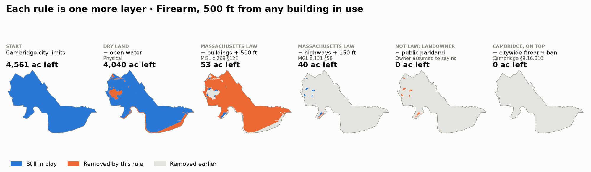
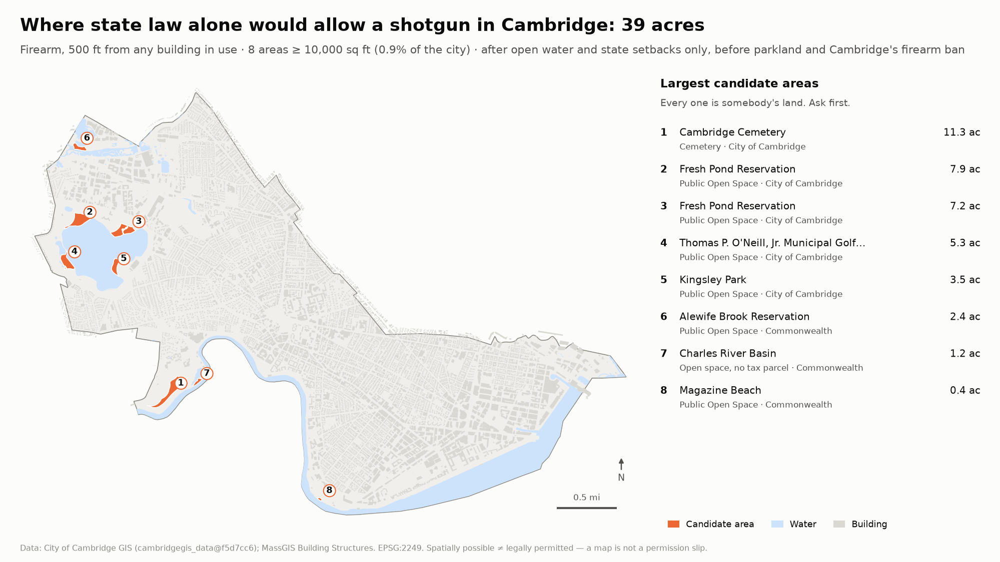

# Can I hunt my Thanksgiving turkey in Cambridge? Methodology

This companion to the Fall NEARC 2026 lightning talk explains how the candidate map was made, what each number means, and what the analysis does not answer. Every rule's source is checked in [claims.md](claims.md). Code and data provenance are in the [README](../README.md). The same stack, run on MassGIS data for every town in Massachusetts, is in [statewide.md](statewide.md).

## Summary

Layers are erased in tiers: open water first, then Massachusetts law, then a landowner assumption that isn't law, then Cambridge's own ordinances on top.

| Scenario | Massachusetts law alone | + public parkland (owner says no) | + Cambridge ordinances | Areas |
|---|---:|---:|---:|---:|
| Firearm, 500 ft from any building in use | 39.2 ac | 0 | **0** | 0 |
| Archery, 500 ft from dwellings (current law) | 132.4 ac | 20.0 ac | **20.0 ac** | 11 |
| Archery, 250 ft from dwellings (pending bill) | 299.3 ac | 78.2 ac | **78.2 ac** | 32 |

- **Firearms: no, and not on Thanksgiving anywhere.** State law alone (no discharge within 500 ft of any building in use, MGL c.269 §12E) leaves 39 acres of Cambridge, all of it City or DCR parkland. Cambridge's citywide ban covers the same ground. Fall turkey season is archery-only on November 26 in any case.
- **Archery: almost no.** At the current 500 ft setback, 20 acres survive in 11 pieces.
- **Cambridge's ordinances add nothing to state law here.** The bow ban in streets and on bridges removes 0.00 acres at 500 ft and 0.01 at 250 ft, because state law already keeps archers 150 ft from every paved road. The firearm ban covers only land the parkland assumption already removed.
- **The biggest judgment call isn't law.** Treating public parkland as closed removes 113 of the 133 acres state law leaves at 500 ft. The public owner (the City or DCR) decides, not a statute.
- **Every candidate acre is someone's land.** The largest 500 ft candidate is crossed by active rail track (see [Known gaps](#known-gaps-and-limitations)).

A candidate is land where the rules as mapped here don't rule hunting out. It is not a place where hunting is permitted. The map shows what is spatially possible, not what is legally allowed.

## Question and scope

**Question.** Where inside Cambridge city limits could a hunter stand without breaking any of the spatial rules in the talk?

**Answer unit.** Polygons of land (candidates) of at least 10,000 sq ft, each split by parcel and tagged with the class of owner.

**Out of scope.** Rules that are not about location: hunting license, turkey permit and archery stamp, season dates and zone, legal days and hours, and whether a landowner agrees. Also out of scope: the direction of the shot and what is behind the target. The season matters on the day itself: Thanksgiving 2026 (Thursday, November 26) falls in the archery-only part of the fall season, so the firearm scenario applies only to the shotgun weeks (October 19–31).

## Rules as geometry

Each rule becomes one geometry and one GIS operation (slides 2–3 of the talk), grouped by what kind of rule it is.

| Tier | Rule | Source | Data | Operation | Parameter |
|---|---|---|---|---|---|
| Dry land | Stand on land, not water | Physical | Water bodies | Erase | — |
| Massachusetts law | No hunting within the setback of a dwelling in use, unless its owner or occupant allows it | MGL c.131 §58; pending bill for 250 ft | Building footprints, land use, MassGIS structures | Buffer + erase | Archery: 500 ft (current), 250 ft (bill) |
| Massachusetts law | No firearm discharge within 500 ft of a dwelling or other building in use, without consent | MGL c.269 §12E | Building footprints, MassGIS structures | Buffer + erase | Firearm: 500 ft |
| Massachusetts law | No firearm or arrow upon, across or within 150 ft of a hard-surfaced highway | MGL c.131 §58 | Road surface polygons | Buffer + erase | 150 ft |
| Not law: landowner | Public parkland, on the assumption the owner says no | None; see [claims.md](claims.md) #5 | Open space | Erase | Owner is City, State, Federal, School Dept., Belmont, POPS, easement or blank |
| Cambridge, on top | No bows in streets or on bridges (archery) | Cambridge §9.16.060 (unverified) | Road surfaces, bridges | Erase | 0 ft |
| Cambridge, on top | No firearm discharge in city limits (firearm) | Cambridge §9.16.010 (unverified) | City boundary | Erase everything | — |
| Tag only | Who owns each acre | MGL c.131 §36 (permission required where posted) | Land-use parcels | Overlay + tag owner class | — |

Two layers from the talk are gone because no rule backs them (see [claims.md](claims.md)):
- **The Fresh Pond water-supply buffer.** It is still in `config.toml` with its distance set to 0.
- **"Only with landowner permission" as a hard rule.** Massachusetts requires the owner's permission only on posted land. It survives as the owner tag.

All parameters live in [`config.toml`](../config.toml), so a changed rule means editing one number and rerunning.

## Data

| Layer | Source | Version | Used for |
|---|---|---|---|
| City boundary | City of Cambridge GIS [3] | `cambridgegis_data` at commit `f5d7cc6` (2026-11-03) | Study area |
| Buildings | City of Cambridge GIS | same | Dwellings; buildings in use |
| Land use FY2027 | City of Cambridge GIS | same | Deciding which buildings are dwellings; owner class |
| Open space | City of Cambridge GIS | same | Parkland |
| Roads (surface polygons) | City of Cambridge GIS | same | Hard-surfaced highways; streets |
| Bridges | City of Cambridge GIS | same | Bridges |
| Water bodies | City of Cambridge GIS | same | Open water |
| Building Structures (2-D) | MassGIS [8] | Queried 2026-11-17 | Structures in neighboring towns within 600 ft of the city line |

The talk cites MassGIS parcels [4] for ownership. This analysis uses the City's parcel-based land-use layer instead, because it also carries use category, residential units and tax status.

Every layer is reprojected to EPSG:2249 (NAD83 / Massachusetts Mainland, US survey feet), so each buffer distance is in the same feet the rules use. File hashes and source URLs are in `data/raw/manifest.json`.

## Method

1. **Study area.** The Cambridge city boundary covers 4,561 acres. That includes the Charles River and Fresh Pond surface inside city limits, which the first step removes (4,040 acres of dry land remain).
2. **Dwellings (archery setback).** A Cambridge building (type `BLDG` or `MOBILE`) is a dwelling if a point inside its footprint falls on a land-use parcel that:
   - has residential units, or
   - is flagged as group quarters, or
   - has a use where people sleep but the assessor may record no units: higher education, education residential, education with commercial, health, hotel, charitable/religious.

   The last group matters because campus parcels lump dorms in with labs and record no residential units. Without it, about 41 acres of university parcels along Massachusetts Avenue come out as 500 ft candidates. Under this definition, 12,330 of 14,278 Cambridge buildings are dwellings.

   The state structures layer has no use code, so every MassGIS structure of at least 200 sq ft that sits outside Cambridge and within 600 ft of the line also counts as a dwelling (2,916 of them). Without these, land along the border would pass the setback test only because the neighboring houses are missing from the city's data.
3. **Buildings in use (firearm setback).** Every Cambridge building of type `BLDG`, `OUTBLDG`, `MOBILE` or `GAS-STATION`, plus every MassGIS structure across the line: 21,148 in all. Overhead walkways, foundations, pads, ruins and construction sites are left out.
4. **Exclusion layers.** Each rule becomes one polygon clipped to city limits:
   - **Open water:** all water bodies.
   - **Setback:** footprints buffered by the scenario's distance, measured from the footprint edge.
   - **Highways:** paved, alley and bridge-deck road surfaces buffered by 150 ft.
   - **Parkland:** open-space polygons with a public owner, or POPS (privately owned public space, which is publicly accessible).
   - **Cambridge:** for archery, every road surface (paved, alley, bridge deck, traffic island, unpaved) plus the bridges layer; for firearms, the whole city.
5. **Waterfall.** The layers are erased in tier order: water, setback, highways, parkland, Cambridge. The order changes how much each step appears to remove, but not what remains.
6. **Three answers per scenario.** After each step, slivers smaller than 10,000 sq ft (about 0.23 acre) are dropped:
   - **Massachusetts law alone:** after the highway step.
   - **Plus parkland:** after the parkland step. This is what the statewide map would say for Cambridge.
   - **The Cambridge answer:** after the Cambridge step.
7. **Owners.** Candidates are intersected with land-use parcels. Each piece gets an owner class from the assessor's tax status: City NonTax becomes "City of Cambridge", Educ NonTax becomes "Educational institution", and so on. A blank tax status becomes "Private (taxable)". Pieces off the parcel map, such as riverbank, take their owner from the open-space layer.

## Results

### Firearm, 500 ft from any building in use

| Step | Tier | Acres left | Removed by this step |
|---|---|---:|---:|
| Cambridge city limits | | 4,561 | — |
| − open water | Dry land | 4,040 | 522 |
| − buildings + 500 ft (c.269 §12E) | Massachusetts law | 53.1 | 3,986 |
| − highways + 150 ft (c.131 §58) | Massachusetts law | 39.5 | 13.6 |
| − public parkland | Not law: landowner | 0 | 39.5 |
| − citywide firearm ban (§9.16.010) | Cambridge | 0 | 0 |

The "only this rule" column is 0 for every step. The parkland assumption and the citywide ban each remove the same 39.5 acres, so dropping either one alone brings nothing back.

The 39.2 acres state law alone leaves (after slivers):
- **City of Cambridge, 35.2 ac:** Cambridge Cemetery 11.3, Fresh Pond Reservation 15.2 in two pieces, the municipal golf course 5.3, Kingsley Park 3.5.
- **DCR, 4.0 ac:** Alewife Brook Reservation 2.4, Charles River Basin 1.2, Magazine Beach 0.4.

### Archery, 500 ft setback (current)

| Step | Tier | Acres left | Removed by this step | Only this rule |
|---|---|---:|---:|---:|
| Cambridge city limits | | 4,561 | — | — |
| − open water | Dry land | 4,040 | 522 | 113 |
| − dwellings + 500 ft (c.131 §58) | Massachusetts law | 202 | 3,838 | 310 |
| − highways + 150 ft (c.131 §58) | Massachusetts law | 133 | 69 | 29 |
| − public parkland | Not law: landowner | 20.1 | 113 | 113 |
| − bows in streets, on bridges (§9.16.060) | Cambridge | 20.1 | 0.00 | 0.00 |
| − slivers under 10,000 sq ft | | 20.0 | 0.2 | — |

**Only this rule** is the acreage that would come back if that one rule were dropped and all the others kept. It is a fairer measure of each rule's weight than "removed by this step", which depends on the erase order. The dwelling setback removes 95% of the city's dry land, yet dropping it alone would return only 310 acres, because other layers cover much of the same ground.

Of the 133 acres state law leaves, 113 are public parkland:
- **City land:** Cambridge Cemetery 37, Fresh Pond Reservation 20, the municipal golf course 13, Kingsley Park 9, Danehy Park 4.
- **DCR land:** Alewife Brook Reservation 14, Magazine Beach 10, Charles River Basin 2.

That one assumption decides more of the answer than any rule except the dwelling setback.

| # | Site | Use | Owner class | Acres |
|---:|---|---|---|---:|
| 1 | 78 Cambridgepark Dr | Transportation | 2 owner classes (mostly Commonwealth) | 5.84 |
| 2 | BB&N Athletic Fields | Education | Educational institution | 5.27 |
| 3 | 725 Concord Ave | Office | Private (taxable) | 2.93 |
| 4 | 101 Smith Pl | Office/R&D | Private (taxable) | 1.26 |
| 5 | 5 Cambridgepark Dr | Transportation | Commonwealth | 1.08 |
| 6 | 155 Fawcett St | Industrial | Private (taxable) | 0.96 |
| 7 | 351 Rindge Ave | Transportation | 2 owner classes | 0.89 |
| 8 | 1 Hampshire St | Office/R&D | Private (taxable) | 0.80 |
| 9 | Mt. Auburn Cemetery | Cemetery | Other nonprofit | 0.41 |
| 10 | 168-210 Alewife Brook Pkwy | Commercial | Private (taxable) | 0.29 |
| 11 | 273 First St | Utility | Private (taxable) | 0.25 |

By owner class: private (taxable) 9.7 ac, educational institution 5.3 ac, Commonwealth 4.3 ac, other nonprofit 0.4 ac. None of it is City of Cambridge land. The BB&N fields are school grounds, where carrying a weapon needs the school's written authorization (MGL c.269 §10(j); see [claims.md](claims.md)).

### Archery, 250 ft setback (pending bill)

| Step | Tier | Acres left | Removed by this step | Only this rule |
|---|---|---:|---:|---:|
| Cambridge city limits | | 4,561 | — | — |
| − open water | Dry land | 4,040 | 522 | 205 |
| − dwellings + 250 ft (c.131 §58) | Massachusetts law | 565 | 3,475 | 251 |
| − highways + 150 ft (c.131 §58) | Massachusetts law | 301 | 264 | 136 |
| − public parkland | Not law: landowner | 79.0 | 222 | 222 |
| − bows in streets, on bridges (§9.16.060) | Cambridge | 79.0 | 0.01 | 0.01 |
| − slivers under 10,000 sq ft | | 78.2 | 0.7 | — |

Halving the setback roughly quadruples the candidate land, from 20 to 78 acres in 32 pieces. Most of the added land is in the Alewife commercial and industrial area, with more in East Cambridge and Kendall; the BB&N fields and the Mt. Auburn Cemetery piece also grow. By owner class: private (taxable) 46.0 ac, educational institution 14.3 ac, Commonwealth 9.3 ac, other nonprofit 6.6 ac, Federal 0.5 ac, City of Cambridge 0.2 ac. The full list is in `outputs/candidates_archery_250ft.csv`.

## Sensitivity: what counts as a dwelling

"Dwelling in use" moves the answer more than the setback bill does.

| Dwelling definition | 500 ft | 250 ft |
|---|---:|---:|
| Buildings on parcels with residential units only | 72.6 ac | 169.8 ac |
| Plus dorm, hotel, hospital and similar parcels (**used**) | 20.0 ac | 78.2 ac |
| Every building in use (the §12E set, including garages and sheds) | 0.0 ac | 5.8 ac |

Counting units alone leaves 56 acres of educational-institution land in play at 500 ft, mostly university parcels on Massachusetts Avenue where students live in dorms the assessor doesn't count as units. Counting every building in use is too strict for archery, since offices, labs and garages are not dwellings, but it bounds the answer: under that reading nothing survives at 500 ft.

## Known gaps and limitations

- **Three Cambridge citations are unverified.** §9.16.010, §9.16.060 and §9.20.010 come from the talk; their text couldn't be retrieved independently. Neither ordinance changes any acreage here, but check them before quoting.
- **Active rail is not a rule here.** Railroad property is not somewhere the public can be, but the talk's stack has no rail layer. The largest 500 ft candidate (archery_500ft-07, 5.8 ac, mostly a state-owned Transportation parcel by Cambridgepark Drive) is crossed by active track in the City's rail layer. At 250 ft, five candidates totaling 25.4 ac are. The City publishes `Trans/Rail/TRANS_Rail.geojson`; adding it as an exclusion is the obvious next rule.
- **Where the arrow goes is not modeled.** §58 also bars releasing an arrow *across* a highway. The model maps where a hunter stands, not the line of fire or what is behind the target.
- **Roads in neighboring towns are only partly covered.** The City's road layer runs past the city line in places (52 acres of road surface outside Cambridge) but is not a complete map of neighboring streets. A road just across the border may be missing its 150 ft buffer. Neighboring buildings, by contrast, come from MassGIS and are covered.
- **Setback waivers are not modeled.** Both setbacks let the owner or occupant consent. The analysis treats every setback as absolute, so written permission from neighbors would open more land.
- **"In use" cannot be observed.** Every building classed as a dwelling, or as a building in use, is treated as occupied.
- **Parkland is an assumption, and a strict one for DCR land.** DCR property is open to hunting by default (302 CMR 12.11) unless listed, and the Alewife Brook Reservation, Magazine Beach and Charles River Basin weren't found on the list. DCR's own 500 ft rules (picnic areas, parking lots, residences) and the narrowness of those strips would shrink them, but the honest label is "ask DCR", which is how the statewide map treats it.
- **Owner class is approximate.** It comes from the assessor's tax status alone. A parcel with no tax status reads "Private (taxable)", including a 0.06 ac sliver of public open space along Alewife Brook Parkway inside archery_500ft-07. Owner names are deliberately not joined. To contact an owner, look up the parcel's map-lot (`ml`) in the Cambridge Property Database.
- **The sliver threshold is a judgment call.** At 10,000 sq ft it drops 60 pieces (0.2 ac) at 500 ft and 124 pieces (0.7 ac) at 250 ft.
- **Data currency.** The city basemap and FY2027 land use are as of 2026-11-03; the MassGIS structures were queried on 2026-11-17. The legal text was checked on 2026-11-20.

## Who decides

The map narrows the question to specific parcels; it doesn't answer it. For each candidate, the decision belongs to:

- the landowner (and, inside a 500 ft ring, the neighbor whose dwelling it is);
- for City land, the City of Cambridge: the Department of Public Works for parks, the Water Department for Fresh Pond Reservation;
- for state reservations, DCR;
- MassWildlife for licensing, seasons and zones.

GIS shows what is spatially possible. These people decide what is permitted.

## References

1. Hunting regulations, Mass.gov. https://www.mass.gov/hunting-regulations
2. Updating hunting laws, Mass.gov. https://www.mass.gov/info-details/updating-hunting-laws
3. GIS data, City of Cambridge. https://www.cambridgema.gov/gis/gisdata (repository: https://github.com/cambridgegis/cambridgegis_data)
4. Parcels, MassGIS Data Hub. https://open-data-massgis.hub.arcgis.com/datasets/CambridgeGIS::parcels/about
5. Code of Ordinances, Cambridge, MA (Municode). https://library.municode.com/ma/cambridge/codes/code_of_ordinances
6. MGL c.131 §58. https://malegislature.gov/Laws/GeneralLaws/PartI/TitleXIX/Chapter131/Section58
7. MGL c.269 §12E. https://malegislature.gov/Laws/GeneralLaws/PartIV/TitleI/Chapter269/Section12E
8. Building Structures (2-D), MassGIS. https://services1.arcgis.com/hGdibHYSPO59RG1h/arcgis/rest/services/Building_Structures/FeatureServer/0
9. MGL c.131 §36 (posted land). https://malegislature.gov/Laws/GeneralLaws/PartI/TitleXIX/Chapter131/Section36
10. S.3064, bill history. https://malegislature.gov/Bills/194/S3064
11. Wild turkey hunting regulations, Mass.gov. https://www.mass.gov/info-details/wild-turkey-hunting-regulations
